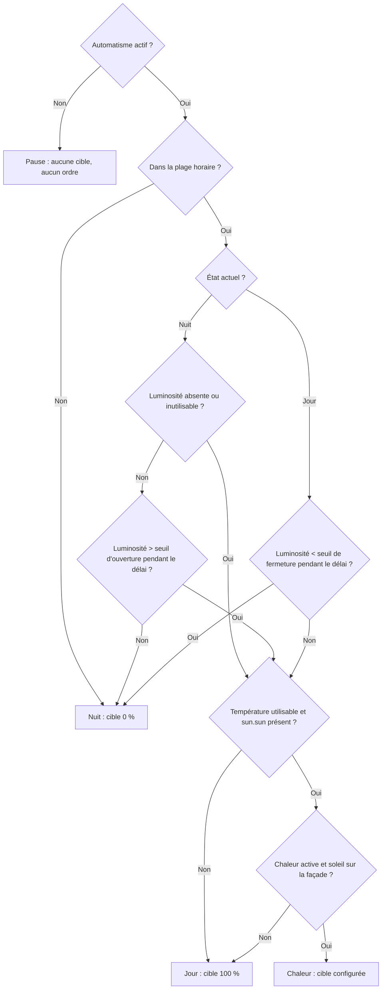
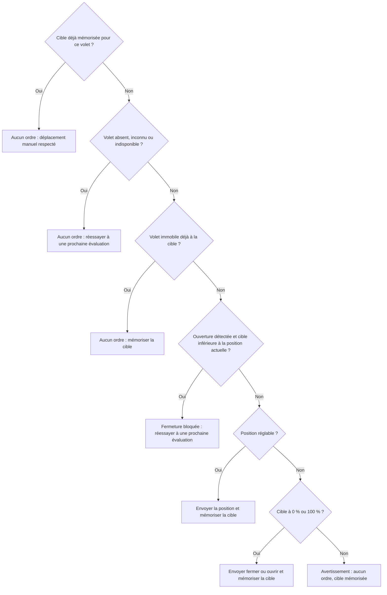

# Cover_Manager

Cover_Manager est une intégration personnalisée [Home Assistant](https://www.home-assistant.io/) qui pilote automatiquement plusieurs volets selon les horaires, la luminosité extérieure, la température et l'orientation solaire.

## Fonctionnalités

- Sélection de plusieurs entités `cover` dans une seule configuration.
- Horaires d'ouverture et de fermeture différents en semaine et le week-end.
- Passage automatique en mode jour ou nuit selon la luminosité extérieure.
- Délai configurable pour éviter les changements dus à une variation lumineuse passagère.
- Fermeture partielle lorsqu'il fait chaud et que le soleil atteint la façade.
- Hystérésis de température pour limiter les allers-retours autour du seuil de chaleur.
- Blocage de toute fermeture tant qu'une porte ou une fenêtre configurée est ouverte.
- Interrupteur pour mettre temporairement l'automatisme en pause.
- Capteur indiquant la règle active, la position cible et la raison de la décision.

## Installation

### Via HACS

1. Ajoutez ce dépôt comme intégration personnalisée dans HACS.
2. Installez **Cover_Manager**.
3. Redémarrez Home Assistant.

### Installation manuelle

1. Copiez `custom_components/cover_manager` dans le dossier `custom_components` de votre configuration Home Assistant.
2. Redémarrez Home Assistant.

> **Migration depuis l'ancien domaine `volets_manager` :** Home Assistant identifie une intégration par son domaine. Après ce renommage, supprimez l'ancienne intégration dans **Paramètres > Appareils et services**, retirez l'ancien dossier `custom_components/volets_manager`, installez la nouvelle version, puis ajoutez **Cover_Manager**. Les options de l'ancienne entrée devront être configurées à nouveau.

## Configuration

1. Dans **Paramètres > Appareils et services**, cliquez sur **Ajouter une intégration**.
2. Recherchez **Cover_Manager**.
3. Saisissez un nom pour le groupe et sélectionnez les volets à piloter.
4. Ouvrez ensuite **Configurer** pour ajuster les options.

### Options disponibles

| Option | Description |
| --- | --- |
| Volets à piloter | Entités `cover` contrôlées par l'intégration |
| Heure d'ouverture | Début de la plage de jour en semaine |
| Heure de fermeture | Fin de la plage de jour en semaine |
| Ouverture / fermeture (week-end) | Horaires facultatifs différents pour samedi et dimanche |
| Capteur de luminosité extérieure | Mesure utilisée pour détecter le jour et la nuit |
| Seuil d'ouverture | Luminosité minimale pour passer en mode jour |
| Seuil de fermeture | Luminosité sous laquelle passer en mode nuit |
| Délai de confirmation | Durée pendant laquelle la condition doit rester vraie |
| Capteur de température extérieure | Mesure utilisée pour activer le mode chaleur |
| Seuil de chaleur | Température d'entrée dans le mode chaleur |
| Position en cas de chaleur | Pourcentage d'ouverture demandé, par exemple `30 %` |
| Azimut solaire min / max | Plage d'azimut correspondant à la façade |
| Élévation solaire minimale | Hauteur minimale du soleil pour prendre en compte la chaleur |
| Capteurs d'ouverture | Fenêtres ou portes qui bloquent toute fermeture |

## Règles de fonctionnement

L'intégration évalue les règles toutes les minutes et lors de tout changement des capteurs configurés.

- **Nuit** : hors de la plage horaire ou en attente de luminosité suffisante, la cible est `0 %`.
- **Jour** : dans la plage horaire et lorsque les conditions lumineuses sont remplies, la cible est `100 %`.
- **Chaleur** : si la température atteint le seuil et que le soleil éclaire suffisamment la façade, la cible est la position de chaleur configurée.
- **Pause** : aucun ordre n'est envoyé tant que l'interrupteur est désactivé.

La position cible n'est envoyée que lorsqu'elle change par rapport à la dernière cible enregistrée pour chaque volet et que le volet n'est pas déjà à cette position. Cela évite de rouvrir systématiquement un volet déplacé manuellement tant qu'une nouvelle règle ne doit pas être appliquée. Si le volet ne fournit pas sa position, son état `open` est considéré comme ouvert à 100 % et son état `closed` comme fermé à 0 % ; une position partielle ne peut pas être vérifiée.

### Schémas de décision

#### 1. Calcul de la cible du groupe



Le samedi et le dimanche, les horaires de week-end remplacent individuellement les horaires habituels lorsqu'ils sont renseignés. L'heure d'ouverture est incluse dans la plage, l'heure de fermeture en est exclue. La plage doit commencer et finir le même jour.

Les seuils de luminosité sont stricts : à égalité, la transition correspondante ne se déclenche pas. Si la luminosité est indisponible, le passage de nuit à jour est immédiat dans la plage horaire ; si l'état est déjà jour, l'intégration y reste. L'état de chaleur s'active à partir du seuil de température et reste actif jusqu'à ce que la température descende en dessous du seuil moins `2 °C`. Le soleil est considéré sur la façade lorsque son azimut est dans la plage configurée et que son élévation atteint le minimum.

#### 2. Application de la cible à chaque volet



Les capteurs d'ouverture s'appliquent à tous les volets du groupe et bloquent les fermetures, pas les ouvertures. Sans position connue, l'intégration estime la position à `0 %` pour un volet `closed`, et à `100 %` dans les autres cas pour décider si l'ordre constitue une fermeture. La cible calculée peut donc différer de la position réelle, notamment si une fermeture est bloquée ou si le volet ne gère pas les positions intermédiaires.

### Exemples concrets

Pour ces exemples, supposons que l'automatisme est actif et que les réglages sont :

| Réglage | Valeur |
| --- | --- |
| Plage horaire | 08:00 à 20:00 |
| Seuils de luminosité | Ouverture : 500 lx ; fermeture : 200 lx |
| Délai de confirmation | 10 minutes |
| Seuil de chaleur | 26 °C |
| Position de chaleur | 30 % |

| Situation | Décision |
| --- | --- |
| À 07:30, hors plage horaire | **Nuit**, cible `0 %`, quelle que soit la luminosité. |
| En état nuit, 600 lx sont observés pendant 10 minutes à partir de 08:00 | Passage en **jour**, cible `100 %`. Avant confirmation, la cible reste `0 %`. |
| En état jour, 150 lx sont observés pendant 10 minutes | Passage en **nuit**, cible `0 %`. Une baisse plus courte ne suffit pas. |
| En état jour, il fait 26 °C et le soleil éclaire la façade | **Chaleur**, cible `30 %`. Avec le soleil toujours sur la façade, la chaleur reste active à 25 °C ; elle se désactive en dessous de 24 °C. |
| La cible est `0 %`, le volet est à `100 %` et une fenêtre configurée est ouverte | La fermeture est **bloquée**. Quand la fenêtre se ferme, une nouvelle évaluation peut envoyer l'ordre. |
| La cible `100 %` n'est pas encore mémorisée et le volet immobile indique déjà `100 %` | Aucun ordre d'ouverture n'est envoyé ; la cible est mémorisée. |
| La cible `100 %` est mémorisée, puis le volet est fermé manuellement | Aucun nouvel ordre tant que la cible reste `100 %`, même après une réévaluation. |
| En état nuit, le capteur de luminosité est indisponible à 09:00 | Passage immédiat en **jour** ; la cible est `100 %`, sauf si la règle chaleur s'applique. |

## Entités créées

Pour chaque configuration, Cover_Manager crée :

- un interrupteur nommé **Automatisme actif** ;
- un capteur nommé **Règle active**.

Le capteur expose les attributs suivants :

- `position_cible` : position demandée, de `0` à `100`, ou `null` en pause ;
- `raison` : explication lisible de la règle courante ;
- `fermeture_bloquee_par` : liste des capteurs d'ouverture actuellement ouverts, susceptibles de bloquer une fermeture.

## Dépannage

- Vérifiez que les entités de capteur utilisent des états numériques.
- Vérifiez que les entités `cover` prennent en charge l'ouverture/fermeture ou la position.
- Si une fermeture est bloquée, contrôlez les entités sélectionnées dans **Capteurs d'ouverture**.
- Les journaux `info` indiquent les changements de règle, les demandes envoyées aux volets et l'activation ou la pause de l'automatisme. Les avertissements signalent notamment les capteurs configurés inutilisables et les positions non prises en charge. Une demande enregistrée ne garantit pas que le volet a terminé son déplacement.
- Activez le niveau `debug` pour voir chaque évaluation, les mesures, les ordres ignorés et les fermetures bloquées :

```yaml
logger:
  default: info
  logs:
    custom_components.cover_manager: debug
```

## Compatibilité

Cette intégration utilise uniquement les services et entités standards de Home Assistant. Elle dépend optionnellement de l'entité `sun.sun` pour le calcul de l'exposition solaire.
